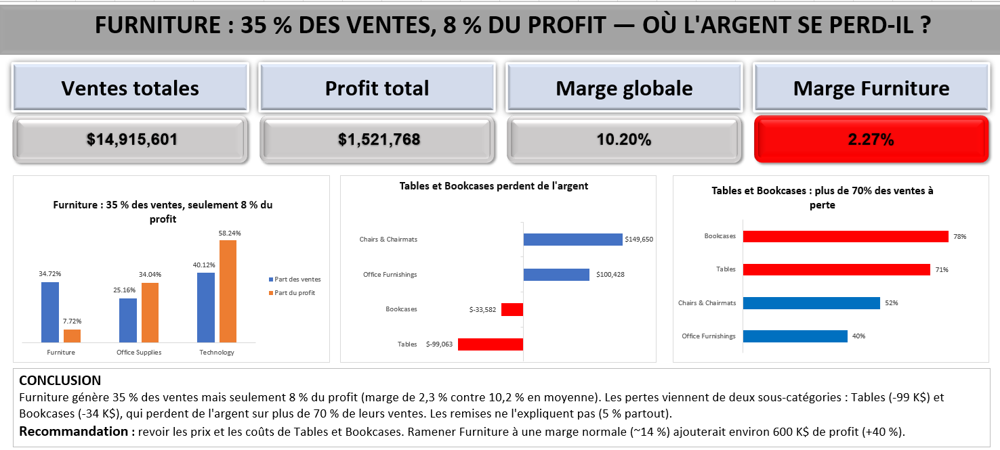

# Superstore Furniture Profitability Analysis (Excel)

Excel analysis of 8,399 order lines from a US office-supply retailer (2009–2012), built to answer one business question and end with a concrete recommendation.

*The dashboard labels are in French.*

## Business Question

**Furniture generates 35% of sales but only 8% of profit — where is the money being lost?**

| Category | Share of sales | Share of profit | Margin |
|---|---|---|---|
| Technology | 40.1% | 58.2% | 14.8% |
| Office Supplies | 25.2% | 34.0% | 13.8% |
| **Furniture** | **34.7%** | **7.7%** | **2.3%** |

Company-wide margin is 10.2%. Furniture is the second-largest category by revenue, yet keeps only $2 of every $100 sold.

## Key Findings

1. **The losses are concentrated in two sub-categories.** Tables (−$99,063) and Bookcases (−$33,582) lose a combined $132,645, cancelling out more than half the profit made by Chairs & Chairmats (+$149,650) and Office Furnishings (+$100,428).
2. **It is a structural problem, not a few bad orders.** 71% of Tables order lines and 78% of Bookcases order lines lose money. The 10 worst Tables orders account for only 18.5% of its total loss.
3. **Discounts do not explain it.** Average discount is 5% in every Furniture sub-category, and the correlation between discount and profit across all orders is −0.04 (effectively none).
4. **Returns do not explain it either.** Return rates are flat at 10–11% across all three categories.

## Recommendation

Review pricing and product costs for **Tables and Bookcases**. Bringing Furniture up to a normal margin (~14%, in line with the other categories) would add roughly **$600K in profit — about +40% for the company**.

## Hypotheses Tested

| Hypothesis | Result |
|---|---|
| Heavy discounting drives Furniture losses | ❌ Rejected — discounts are identical (5%) across sub-categories; correlation with profit ≈ 0 |
| High return rates drive Furniture losses | ❌ Rejected — returns are 10–11% in every category |
| Shipping costs drive the losses | ⚠️ Inconclusive — some profitable sub-categories (e.g. Paper) carry higher shipping relative to price |
| A few large loss-making orders skew the totals | ❌ Rejected — most Tables and Bookcases orders lose money |

## Data Preparation

Work done in the `Commandes` (orders) sheet:

- **Zip codes:** rebuilt as 5-digit text with `TEXT(zip,"00000")` to restore leading zeros lost on import (e.g. New Jersey `07101`)
- **Missing values:** 63 missing Product Base Margin values imputed with their category average (`FILLED_MARGIN`)
- **Table joins:** each order linked to the Returns table and to its regional manager with `XLOOKUP`
- **New fields:** profit margin per line, and an `À perte` flag (`=IF(Profit<0,1,0)`) to measure the share of loss-making orders
- **KPI fix:** the original "Total Orders" KPI counted rows (8,399). Because one order can contain several products, true order count is **5,496** distinct Order IDs (`COUNTA(UNIQUE(...))`), which also corrected Average Order Value from $1,776 to **$2,714**
- **Workbook cleanup:** removed a duplicate copy of the orders sheet, repointed a pivot table that depended on it, renamed all sheets descriptively, and moved summary statistics to their own sheet

## Skills Demonstrated

- Pivot tables and PivotCharts (value shown as % of column total, average of a flag, report filters)
- Formulas: `SUMIFS`, `XLOOKUP`, `COUNTA(UNIQUE())`, `IF`, `TEXT`, `CORREL`, `STDEV.P`
- Data cleaning and imputation
- Dashboard design: KPI cards linked to calculation cells, consistent colour coding (red = problem), titles that state the finding
- Analytical reasoning: forming hypotheses, testing them, and reporting what the data can and cannot prove

## Workbook Structure

| Sheet | Contents |
|---|---|
| Tableau de bord | Final dashboard |
| Ventes vs profit | Share of sales vs share of profit by category |
| Profit Furniture | Profit by Furniture sub-category |
| Commandes à perte | % of loss-making order lines by sub-category |
| Commandes | Cleaned order-level data |
| Retours / Managers régionaux | Returns and regional manager lookup tables |
| Analyse des retours | Supporting analysis of returns and monthly trends |
| Statistiques | Summary statistics (correlation, standard deviation, weighted margin) |

## Limitations

- The dataset contains selling price and shipping cost but **no product purchase cost**, so the exact cause of the Tables and Bookcases losses (underpricing vs. high supplier cost) cannot be proven from this data alone.
- Returns are recorded at order level, so every line in a returned order is flagged as returned.

## Author

Nithin Naga Sai
